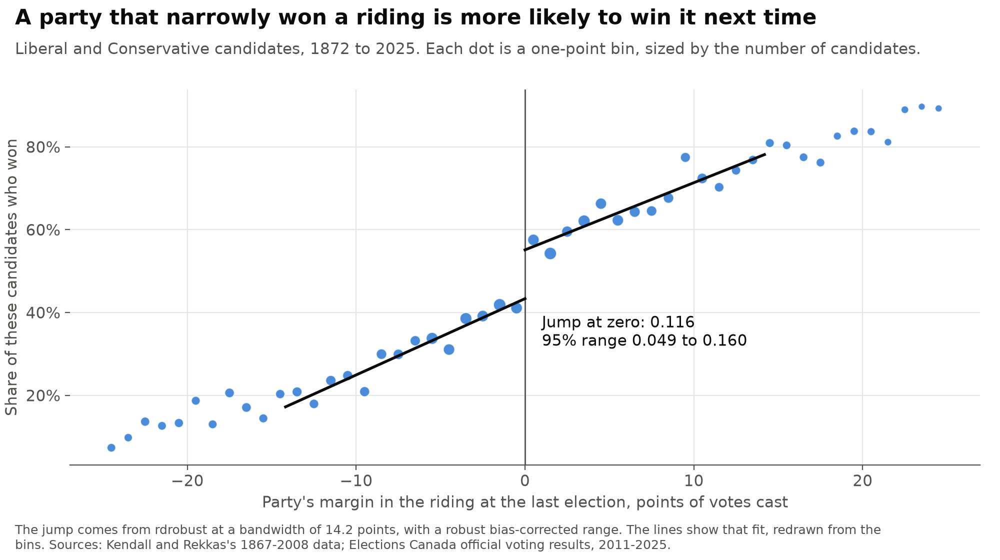
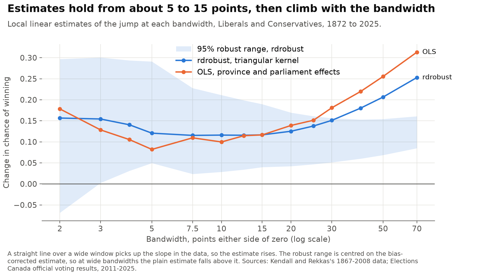
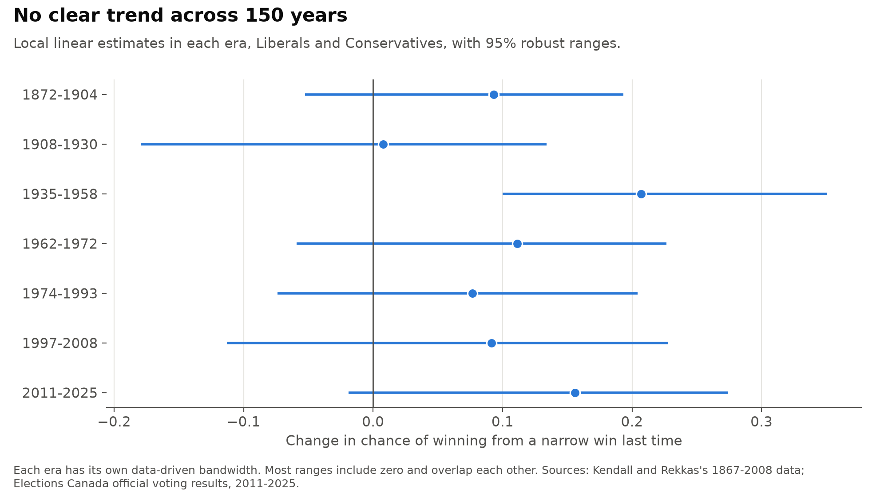
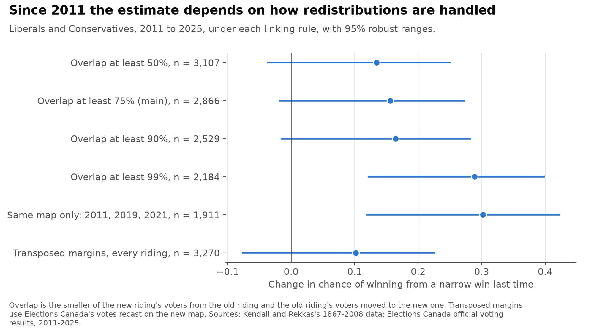
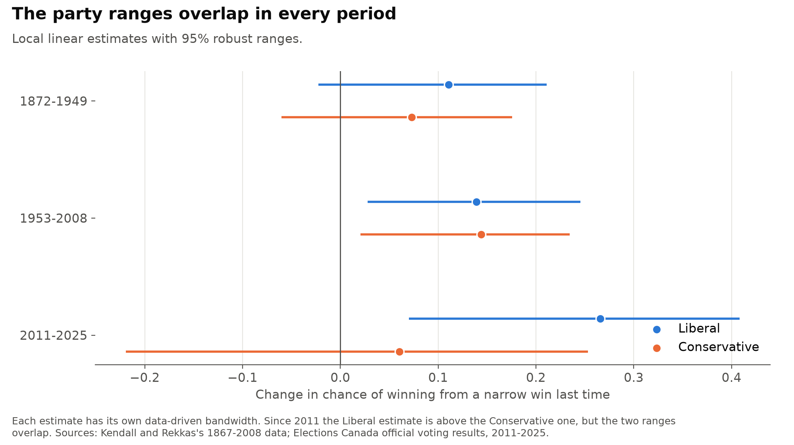
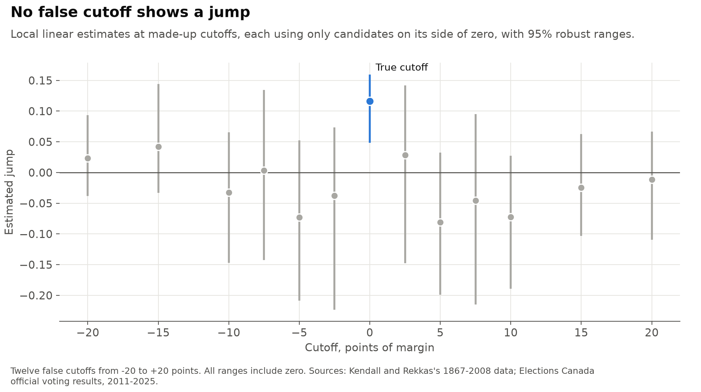

# canada_incumbency_rd

[](https://github.com/atamalfuzi/canada_incumbency_rd/actions/workflows/tests.yml)

Does a party that narrowly wins a Canadian federal riding become more likely to win it next time? This repeats my 2022 replication of Kendall and Rekkas, "Incumbency advantages in the Canadian Parliament" (*Canadian Journal of Economics*, 2012), adds current regression discontinuity methods, and extends the elections from 2008 through 2025. Python, with statsmodels, rdrobust, rddensity and geopandas.

> **Personal project.** This is my own analysis of publicly available data. It is not associated with my work for any current or past employer and does not represent their views.

| Question | Methods | Answer |
|---|---|---|
| [Do the 2022 numbers reproduce?](#1-do-the-2022-numbers-reproduce) | The Stata regressions rewritten in Python, as a test | Yes: all 20 estimates, standard errors and sample sizes, and the 5 means. |
| [How large is the advantage?](#2-how-large-is-the-advantage) | Local linear RD with a data-driven bandwidth and robust range | A narrow win adds 11.6 points to the chance of winning next time (4.9 to 16.0). |
| [Does it depend on the bandwidth?](#3-does-it-depend-on-the-bandwidth) | The same estimate at 14 bandwidths | Little from 5 to 15 points, then it rises with the bandwidth. |
| [Has it changed since 2008?](#4-has-it-changed-since-2008) | Riding links across two redistributions | Can't tell. It is 15.6 points since 2011 (−1.9 to 27.4), and the range runs from 10 to 30 depending on the linking rule. |
| [Does the margin's denominator matter?](#6-does-the-margins-denominator-matter) | Votes over eligible voters, 2006 to 2025 | Little: 14.2 points on votes cast and 12.7 on eligible voters. |

Ranges are 95%. A point here is a percentage point, so 0.116 in a table is 11.6 points.

## What it shows

### 1. Do the 2022 numbers reproduce?

Yes. `tests/test_estimate.py` checks every cell of the 2022 results table against the Python rewrite: four specifications in each of five groups, with their standard errors and sample sizes, plus the means.

| Specification | 2022, 1872–2008 | Standard error | N | This repo, 1872–2025 | Standard error | N |
|---|---:|---:|---:|---:|---:|---:|
| Linear, ±15% | 0.112 | 0.032 | 6,465 | 0.117 | 0.030 | 7,430 |
| Linear, ±10% | 0.094 | 0.038 | 4,742 | 0.100 | 0.035 | 5,406 |
| Cubic, ±70% | 0.094 | 0.033 | 13,195 | 0.098 | 0.030 | 16,024 |
| Quartic, ±70% | 0.102 | 0.039 | 13,195 | 0.100 | 0.036 | 16,024 |

The sample is Liberal and Conservative candidates in ridings where the party also ran last time. Conservative includes the Progressive Conservatives; the file counts Reform and the Canadian Alliance as a separate party. The regressions include province and parliament effects and cluster by riding. The cubic and quartic rows are here only to compare with the paper. High-order polynomials over a wide window give noisy results that depend on the degree chosen and intervals that are too narrow (Gelman and Imbens, 2019), so nothing below relies on them.

### 2. How large is the advantage?



| Sample | Estimate | 95% robust range | Bandwidth | Candidates |
|---|---:|---:|---:|---:|
| 1872–2008 | 0.113 | 0.042 to 0.160 | 15.2 | 13,653 |
| 1872–2025 | 0.116 | 0.049 to 0.160 | 14.2 | 16,519 |
| 1872–2025, province and parliament effects | 0.111 | 0.045 to 0.152 | 14.4 | 16,519 |

These use a triangular kernel and a mean squared error bandwidth, with standard errors clustered by riding and bias-corrected ranges (Calonico, Cattaneo and Titiunik, 2014). The new method agrees with the 2022 ±15% estimate. The 2022 window happens to sit close to the bandwidth the data select.

An RD compares candidates just either side of winning, so this describes close races only. It covers the party's overall advantage, and I did not repeat the paper's split between party and individual effects.

### 3. Does it depend on the bandwidth?

My 2022 critique of the paper asked for more bandwidths than ±10% and ±15%.



| Bandwidth, points | rdrobust | Bias-corrected | 95% robust range | OLS with effects |
|---:|---:|---:|---:|---:|
| 2 | 0.157 | 0.114 | −0.069 to 0.297 | 0.178 |
| 5 | 0.121 | 0.170 | 0.049 to 0.291 | 0.082 |
| 10 | 0.116 | 0.120 | 0.029 to 0.211 | 0.100 |
| 15 | 0.117 | 0.115 | 0.040 to 0.190 | 0.117 |
| 20 | 0.125 | 0.106 | 0.042 to 0.169 | 0.139 |
| 30 | 0.151 | 0.104 | 0.051 to 0.156 | 0.181 |
| 50 | 0.206 | 0.111 | 0.069 to 0.154 | 0.255 |
| 70 | 0.253 | 0.123 | 0.085 to 0.161 | 0.313 |

The rise past 20 points comes from fitting a straight line through a curved relationship, and the bias-corrected column stays between 0.10 and 0.12 from 10 points up. Below 5 points the range is too wide to say much. All 14 bandwidths are in [output/bandwidth.csv](output/bandwidth.csv).

### 4. Has it changed since 2008?

| Period | Estimate | 95% robust range | Candidates | Change from 1953–2008 (standard error) |
|---|---:|---:|---:|---:|
| 1872–1949 | 0.088 | −0.015 to 0.162 | 4,845 | −0.051 (0.053) |
| 1953–2008 | 0.139 | 0.053 to 0.202 | 8,808 | |
| 2011–2025 | 0.156 | −0.019 to 0.274 | 2,866 | +0.017 (0.075) |



The data can't separate these periods, and the range since 2011 includes zero. One election is too few to say anything: at a ±15 bandwidth the estimates for single elections run from −0.23 in 2015 to 0.47 in 2021, with ranges about 80 to 100 points wide ([output/elections.csv](output/elections.csv)).

The estimate since 2011 also depends on how the two redistributions are handled:



Using only elections on an unchanged map gives 0.30 (0.12 to 0.42). Those exclude 2015 and 2025, the two elections right after a redistribution, which were also large Liberal gains, so this can't tell which of the two lowers the estimate. Using transposed margins for every riding gives 0.10 (−0.08 to 0.23), but in that version the party with the notional lead may not hold the seat, which should shrink the estimate.

**How ridings were linked.** The paper requires identical riding names, which would lose nearly every riding at a redistribution. I link a new riding to an old one by the voters they share. Overlap is the smaller of two shares: the new riding's voters who came from the old riding, and the old riding's voters who went to the new one. The main rule needs at least 75%.

| Redistribution | Ridings | Linked at 75% | **Not linked** | At 50% | At 90% | At 99% | Voters measured with |
|---|---:|---:|---:|---:|---:|---:|---|
| 2011 to 2015 (2013 order) | 338 | 217 | **121** | 293 | 140 | 72 | Elections Canada's transposition of 2011 votes |
| 2021 to 2025 (2023 order) | 343 | 283 | **60** | 333 | 183 | 68 | 2021 polls placed on the 2023 map, by electors |

Every riding and its overlap is in [output/riding_links.csv](output/riding_links.csv). A further 53 ridings are dropped across the five elections because a by-election came between general elections. The paper instead used the by-election margin, or dropped the observations as a check, and reports no change in its qualitative results.

Elections Canada published old-to-new voter flows for 2013 but only totals for 2023, so I rebuilt the 2023 flows from polling division boundaries and poll results. Each poll goes whole to the 2023 riding holding its largest part, which leaves some error where a new boundary cuts a poll. The rebuilt flows compare with official figures as follows ([output/link_checks.csv](output/link_checks.csv)):

- Electors by 2023 riding correlate 0.999 with the official transposed counts, with a median gap of 0.3%.
- The largest party share gap against the official transposed votes has a median of 2.1 points, partly because only ordinary polls can be placed on a map.
- All 43 officially unchanged ridings I could find by name come out at full overlap. Five more were renamed and can't be checked that way.
- Where a sitting MP ran again in a linked riding, the MP has the surname of the old riding's last winner in 162 of 167 cases in 2015 and 214 of 215 in 2025.

### 5. Do parties differ?



| Party | 1872–1949 | 1953–2008 | 2011–2025 |
|---|---:|---:|---:|
| Liberal | 0.111 (−0.023 to 0.211) | 0.139 (0.028 to 0.245) | 0.266 (0.070 to 0.408) |
| Conservative | 0.073 (−0.060 to 0.176) | 0.144 (0.021 to 0.235) | 0.060 (−0.219 to 0.253) |
| NDP, with the CCF | | 0.065 (−0.220 to 0.290) | 0.027 (−0.335 to 0.298) |
| Bloc Québécois | | −0.285 (−0.773 to 0.046) | 0.487 (0.192 to 0.876) |

Since 2011 the Liberal estimate is 0.21 above the Conservative one, about 1.6 standard errors, so the difference could be noise. The critique also asked to look past the two main parties. The NDP and Bloc estimates rest on few close races (about 100 to 400 candidates inside the bandwidth), and the Bloc's earlier estimate covers only 1997 to 2008. The swing in the Bloc's numbers is too imprecise to interpret.

### 6. Does the margin's denominator matter?

The critique argued that the margin should be divided by eligible voters, not votes cast, because turnout can be in a party's interest. Elections Canada's riding tables give elector counts from 2004, so this covers outcomes from 2006 to 2025, on the same 4,004 rows.

| Margin | Estimate | 95% robust range | Bandwidth, points |
|---|---:|---:|---:|
| Share of votes cast | 0.142 | −0.002 to 0.238 | 14.0 |
| Share of eligible voters | 0.127 | −0.012 to 0.217 | 9.4 |
| Votes cast, turnout above the median of 64% | 0.074 | −0.156 to 0.227 | 12.2 |
| Votes cast, turnout below the median | 0.166 | 0.001 to 0.280 | 23.8 |

The denominator changes little. It can't change who won, so the cutoff stays in place and only the scale of the margin moves. This doesn't rule out turnout mattering in other ways: the estimate is lower where turnout was high, though the two ranges overlap widely.

### 7. Checks

The critique said the paper assumed close races are as good as random without enough evidence.



| Check | Result |
|---|---|
| False cutoffs, 12 from −20 to +20 | All ranges include zero. |
| Density at the cutoff (Cattaneo, Jansson and Ma), by party and period, 8 tests | Conservatives have p = 0.03 overall and p = 0.02 for 1872–1949. The others are above 0.10, including both parties since 2011 (0.10 and 0.24). |
| Balance on 6 earlier traits, all years | One of six is below 5%: narrow winners were 6.2 points less likely to have won two elections back (−15.5 to −0.2). Party margin two elections back is close, at p = 0.11. |
| Balance on the same 6 traits, 2011–2025 | None below 5%, with wide ranges. |
| Does a narrow win change whether the party runs again? | No: +0.006 (−0.029 to 0.032), with 94% running again. This tests the party exit concern in the critique. |

Most of this supports the design. The two results to keep in mind are the Conservative density before 1950 and the imbalance on winning two elections back. With about 35 tests, one or two below 5% are expected by chance, though I can't rule out real sorting in the early period. Density tests are run by party because pooling is uninformative: in a close Liberal and Conservative race, the winner and loser land at mirrored margins by construction.

### Issues in the source file

The 2008 winners' margins in the 1867–2008 file are wrong for 159 of 308 ridings, because they are measured against the third-place candidate instead of the runner-up. This doesn't affect the 2022 numbers, since the sample's last margins come from 2006, but anyone extending the file would inherit it. I take all margins from 2008 on from Elections Canada's tables instead. The file's 2004 and 2006 margins match my rebuild from official tables to within rounding. The 2022 sample has no 1917 outcomes, as in the paper, but does keep 6 rows from 1921, which the paper omits.

Not covered: the paper's party and individual split, and campaign spending, which the critique also raised.

## Data and licences

| Source | Used for | Licence |
|---|---|---|
| Kendall and Rekkas's candidate file, 1867–2008, built from Library of Parliament records according to the paper | 1872–2008 estimates | I found no licence, so it is **not in this repo**. My copy comes from the 2022 assignment. |
| [Official Voting Results, Tables 11 and 12](https://www.elections.ca/content.aspx?section=res&dir=rep/off&document=index&lang=e), Elections Canada: 2004, 2006, 2008, 2011, 2015, 2019, 2021 | Results and elector counts | Open Government Licence – Canada ([2015](https://open.canada.ca/data/en/dataset/775f3136-1aa3-4854-a51e-1a2dab362525), [2019](https://open.canada.ca/data/en/dataset/199e5070-2fd5-49d3-aa21-aece08964d18), [2021](https://open.canada.ca/data/en/dataset/065439a9-c194-4259-9c95-245a852be4a1)). The earlier years' records I checked are their poll-by-poll results ([2008](https://open.canada.ca/data/en/dataset/d356c792-5cb0-46c1-be74-a86f804a0e93), [2011](https://open.canada.ca/data/en/dataset/b1fabdfd-72c5-42b0-a07e-a04e0148f7a4)). |
| [45th General Election: Official Voting Results](https://www.elections.ca/content.aspx?section=res&dir=rep/off/45gedata&document=summary&lang=e), Elections Canada, 2025 | Results and elector counts | I found no open data record yet. Elections Canada's [terms](https://www.elections.ca/content.aspx?section=pri&document=index&lang=e) allow non-commercial reproduction with attribution. |
| [Transposition of Votes, 2013 Representation Order](https://www.elections.ca/res/cir/trans2013/default.asp?lang=e) and [Transposition of Votes from the 44th General Election to the 2023 Representation Orders](https://www.elections.ca/content.aspx?section=res&dir=rep/tra/2023rep&document=index&lang=e), Elections Canada | Links and transposed margins | Elections Canada's terms, as above. |
| [Polling Division Boundaries – Canada 2021](https://open.canada.ca/data/en/dataset/0ed37cd6-d831-4183-bf43-b05e29570298), [Federal Electoral Districts – Canada 2023](https://open.canada.ca/data/en/dataset/18bf3ea7-1940-46ec-af52-9ba3f77ed708) and [Poll-by-Poll Results, 44th General Election](https://www.elections.ca/content.aspx?section=res&dir=rep/off/44gedata&document=index&lang=e), Elections Canada | 2023 flows | Open Government Licence – Canada for both boundary files. I did not open the 2021 poll-by-poll record; the 2008, 2011 and 2015 ones carry this licence. |

What is committed: code, estimates, one-point bin averages and the riding links, which hold riding names and shares. No candidate names or vote counts are committed, and `data/` stays out of the repo. The tables in `output/` are copies derived from the versions at the addresses above, and reasonable care was taken to check them; they aren't official Elections Canada figures. Contains information licensed under the Open Government Licence – Canada. The MIT licence covers the code only.

## Run it

Python 3.12:

```
python -m venv .venv
.venv\Scripts\activate          # Windows; on macOS or Linux: source .venv/bin/activate
pip install -r requirements.txt
python data.py
python estimate.py
python checks.py
python figures.py
```

Run them from the repository folder, in this order. `data.py` downloads about 110 MB into `data/raw/`, and the whole run takes about 4 minutes. Results reproduce exactly on the same data.

`estimate.py` and `checks.py` need the 1867–2008 file at `data/original_elections.csv`, or at the path in `ORIGINAL_ELECTIONS`. Without it, `data.py` still builds the links and the official samples for 2006 to 2025, and `figures.py` still draws from the committed tables.

To run the tests: `pip install -r requirements-dev.txt`, then `pytest`. Without the data, they check the committed tables against the 2022 numbers and the estimators on made-up data, and skip the four tests that read the source file and official tables. With both in place, all 19 run.

## References

- Calonico, S., Cattaneo, M. D. and Titiunik, R. (2014). Robust nonparametric confidence intervals for regression-discontinuity designs. *Econometrica*, 82(6).
- Cattaneo, M. D., Jansson, M. and Ma, X. (2020). Simple local polynomial density estimators. *Journal of the American Statistical Association*, 115(531).
- Gelman, A. and Imbens, G. (2019). Why high-order polynomials should not be used in regression discontinuity designs. *Journal of Business & Economic Statistics*, 37(3).
- Kendall, C. and Rekkas, M. (2012). Incumbency advantages in the Canadian Parliament. *Canadian Journal of Economics*, 45(4), 1560–1585.

## License

Code: [MIT](LICENSE).
